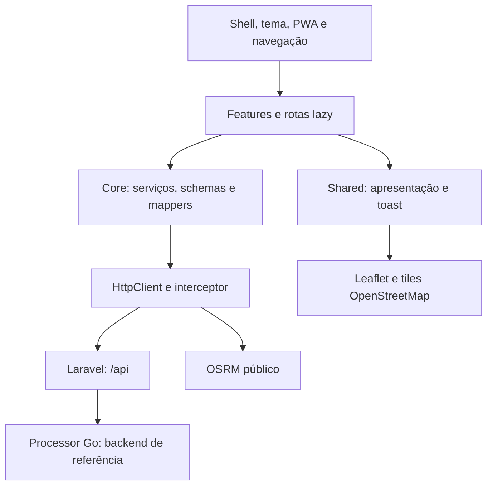

# Arquitetura do frontend

Estado observado em 24/10/2026: SPA Angular standalone com rotas lazy e injeção de dependências. Não há SSR configurado em `angular.json`.

O projeto é Open Transit, nome oficial provisório. Identificadores `mobility-*` e nomes do manifest são detalhes existentes, preservados; consulte a [política de identidade e o estado das entregas](../README.md). Mobile-only/PWA-first é a diretriz de evolução, com divergências atuais registradas na auditoria.

| Área                            | Responsabilidade observada                                                     |
| ------------------------------- | ------------------------------------------------------------------------------ |
| `core/services`                 | Auth, temas, PWA, linhas, favoritos, posições e paradas                        |
| `core/guards`, `interceptors`   | Entrada pública/autenticada, escopo do Bearer e 401                            |
| `core/schemas`, `mappers`       | Zod, DTOs e adaptação de identidades/envelopes                                 |
| `shared/components`, `services` | Navegação, ícones, cards, mapa, tema, toast e status PWA                       |
| `features`                      | Telas, estado e coordenação dos serviços                                       |
| `features/preview`              | Providers de fixtures e identidade sintética por rota; somente desenvolvimento |

`AppComponent` usa template inline. `app.html`/`app.css` antigos não são referenciados por ele. Existem CSS antigos sem vínculo nos componentes de login/cadastro; conferir referências antes de remover em tarefa própria. Em detalhes, `line-details-light.css` está explicitamente referenciado em `styleUrls` junto de `line-details.css` e deve acompanhar a publicação.

## Rotas e sessão

| Rotas                                                                        | Acesso                                                                                       |
| ---------------------------------------------------------------------------- | -------------------------------------------------------------------------------------------- |
| `/`, `/login`, `/register`                                                   | `guestGuard`: sessão local presente leva a `/home`                                           |
| `/home`, `/search`, `/lines/:id`, `/favorites`, `/map`, `/stops`, `/profile` | `authGuard`: sem token leva a `/login`                                                       |
| `/preview/*`                                                                 | Somente desenvolvimento; identidade sintética e serviços de exemplo; inexistente em produção |
| desconhecida                                                                 | Redireciona para `/`                                                                         |

Login/cadastro levam a `/home`. A barra tem Início, Buscar, Mapa, Favoritos e Perfil; o shell a omite nas entradas públicas, detalhes e paradas. A prévia mantém navegação interna em `/preview`; somente ações explícitas de saída retornam à experiência real.

Auth persiste token e usuário em localStorage. Guard verifica presença, não validade no servidor. Interceptor restringe Bearer à origem/caminho da API, exclui login/cadastro e limpa sessão em 401 protegido. Logout limpa primeiro no cliente e tenta revogação remota com token capturado.

## Limite de demonstração

`app.routes.ts` compõe as rotas reais com `PREVIEW_ENTRY_ROUTES` de `preview.config.ts`. Em desenvolvimento, esse arquivo oferece o carregamento lazy de `features/preview`. Em produção, `angular.json` o substitui por `preview.config.prod.ts`, que exporta lista vazia e `PREVIEW_ENABLED=false`, sem importar a demonstração. Essa mesma flag oculta links de demonstração em Home, busca, mapa e paradas. O fallback de URL desconhecida continua indo à entrada normal, sem renderizar demo; HTTP 200 do servidor SPA não prova disponibilidade da rota.

Somente a árvore de `/preview` recebe overrides de Auth, BusLines, Favorites, Realtime e Stops. `PreviewAuthService` retorna identidade sintética (`demo@example.invalid`), token nulo e autenticação falsa; não lê/grava localStorage nem revoga a sessão. Favoritos demonstrativos ficam em memória. Guard/shell e a saída explícita mantêm a sessão real da aplicação; as páginas da demonstração não mostram essa identidade. Ao retornar a uma rota real, os serviços oficiais continuam sendo usados e falhas HTTP não viram fixtures. Tema permanece compartilhado; tiles/serviços externos de mapa continuam dependendo de rede.

## Evolução e limites

`HEAD af4a148` já tinha core/shared/features, lazy routes, HttpClient, Zod, RxJS, Signals, auth e Leaflet. Os lotes acrescentam shell/temas/Home e entrada pública/PWA; a árvore atual contém trabalho adicional. As baselines anteriores aos lotes incluem código ausente no HEAD: diff contra HEAD não basta para atribuir origem temporal.

UI usa Signals/computed, HTTP usa RxJS, mapa/detalhes fazem polling de 10 s. Há normalização duplicada e `any` legado. API: `http://localhost:8000/api` em desenvolvimento e `/api` em produção. OSRM e tiles dependem de rede externa. Veja [contratos](api-contracts.md) e [auditoria](audits/2026-10-24-frontend-audit.md).
